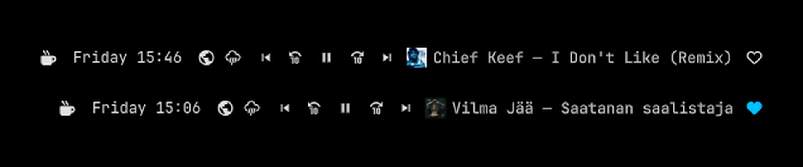

# Spotify Like

An Omarchy bar widget: a heart next to your media widget that shows whether
the Spotify track playing now is in your Liked Songs.

- Outline heart: not liked. Left-click adds the track to Liked Songs.
- Filled heart in the theme's accent colour: liked. Right-click removes it
  (so a stray left-click never unlikes a song).
- Likes you make in the Spotify app show up in the bar within a few seconds.
- It sits next to your media widget, on the side you choose, and shows and
  hides the way that widget shows Spotify (see [Settings](#settings)). It's
  hidden for podcasts and ads, which can't be liked.

It works on **Spotify Free**. Spotify's Web API needs Premium and a developer
app for this, so instead a small [Spicetify](https://spicetify.app) extension
inside the desktop app uses the app's own library functions and reports to
the bar over a local connection.



## Requirements

- Omarchy (Quattro)
- Spotify desktop app from the Omarchy package (`/opt/spotify`)
- [`spicetify-cli`](https://aur.archlinux.org/packages/spicetify-cli) from the AUR
- `python` (`/usr/bin/python3`), `acl` (`setfacl`) and `util-linux` (`unshare`).
  The last two are always installed; `setup/install` tells you if anything is missing.
- Unprivileged user namespaces (on by default in Arch kernels), used to run
  Spicetify offline

## Install

```bash
omarchy pkg aur add spicetify-cli
omarchy plugin add https://github.com/freezombie/omarchy-spotify-like --enable
~/.config/omarchy/plugins/freezombie.spotify-like/setup/install
```

`setup/install` explains each change and asks before making it:

1. Gives your user write access to `/opt/spotify` with ACLs (needs sudo).
   Spicetify has to patch files there.
2. Offers safer Spicetify settings (see [Security](#security)). Default yes
   on a fresh Spicetify; if you already use Spicetify themes or extensions,
   the default is no and nothing else in your setup changes.
3. Creates a random secret in `~/.config/spotify-like/secret` (readable only
   by you) and gives Spicetify a private copy of the `spotify-like-bridge.js`
   extension with that secret in it. Adds the extension to Spicetify's list,
   next to any extensions you already have.
4. Patches Spotify, offline. If Spotify is open, it's closed for that and
   started again afterwards (it crashes if its files change while it runs).
5. Offers a post-update hook (`~/.config/omarchy/hooks/post-update.d/spotify-like-repatch`)
   that re-patches Spotify after `omarchy update` installs a new Spotify
   (closing and reopening Spotify if it's running).
6. Asks which side of your media widget the heart goes on (right, left, or
   leave it where it is) and moves it there. This is the `placement` setting
   below.

It's safe to run again. `--yes` accepts the default answers.

## Usage

Click the heart. The same actions are available over IPC, for keybindings:

```bash
omarchy-shell freezombie.spotify-like status   # {"connected":true,"uri":"spotify:track:…","liked":false,…}
omarchy-shell freezombie.spotify-like like
omarchy-shell freezombie.spotify-like unlike
omarchy-shell freezombie.spotify-like toggle
omarchy-shell freezombie.spotify-like place after   # or before: put it next to the media widget now
```

## Settings

Set these with `omarchy bar set freezombie.spotify-like <setting> <value>`.

| Setting | Values | Default |
|---|---|---|
| `placement` | `after` (right of the media widget; below it on a vertical bar), `before` (left; above), `manual` | `manual` until `setup/install` asks |
| `hideWhen` | `auto`, `never`, `stopped`, `paused` | `auto` |
| `mediaWidget` | a widget id | recognised automatically |

**Placement.** With `after` or `before`, the heart moves next to your media
widget when you set it, when you switch to another media widget, and when you
move the media widget. If you drag the heart somewhere else yourself, it
stays there (until you change `placement` or run `omarchy-shell
freezombie.spotify-like place after`). It moves itself with
`omarchy bar move`, which edits your `shell.json`; `manual` leaves your bar
alone.

**When it hides.** Media widgets differ on a Spotify that has a song loaded but
isn't playing (right after it opens, until you press play). With `auto` the
heart does what your media widget does:

| Media widget | Stopped Spotify |
|---|---|
| `crmne.mpris` | hidden |
| `io.github.qempexe.omaudix` | hidden; follows its own `hideWhen` |
| `io.github.erikburdett.wavebar` | shown; hidden while paused with its `hideWhenPaused` |
| `omarchy.media` (built in), `now-playing`, `custom.media`, `io.github.elliotalien.tide`, `nenadjokic.navibeat`, `lancefaul.omedia-controls`, `bibek.media`, `io.github.joshz7.afterglow`, `celestune-bar` | shown |

`never` shows the heart whenever a song is loaded, `stopped` hides it while
Spotify is stopped, and `paused` whenever Spotify isn't playing. In every case
it hides while another player (a video in the browser, say) is playing and
Spotify isn't, because media widgets then show that player instead.

**Other media widgets.** If yours isn't in the table, for example a clone such
as `yourname.media`, name it so placement and `auto` use it:

```bash
omarchy bar set freezombie.spotify-like mediaWidget yourname.media
```

`quickshell.spotify` and OmaSpotify have a heart of their own for their built-in
player; this plugin is for the Spotify desktop app.

## Updating

```bash
omarchy plugin update freezombie.spotify-like
~/.config/omarchy/plugins/freezombie.spotify-like/setup/install
omarchy restart shell
```

Spicetify copies the extension into Spotify when it patches, so run
`setup/install` again after an update to pick up a changed extension
(the post-update hook also does this when it re-patches). **Updating from
0.1.x:** the extension and the bar now authenticate each other, so the heart
stays disconnected until you run `setup/install` again. The
shell keeps the plugin's service loaded, so restart it to load a changed
`Service.qml`.

## Removal

```bash
~/.config/omarchy/plugins/freezombie.spotify-like/setup/uninstall
omarchy plugin remove freezombie.spotify-like
```

`setup/uninstall` removes the extension and the shared secret, and puts
back the settings install changed. It removes the hook and, once Spotify is back to
stock, your write access to `/opt/spotify`. If install set Spicetify up for
this plugin alone, it offers `spicetify restore`. If you use Spicetify for
other things, it re-applies your setup without this extension.

## Troubleshooting

- **No heart while a song plays.** Run `omarchy-shell freezombie.spotify-like status`.
  - `"showHeart":false` with `"spotifyStopped":true` means Spotify hasn't
    started playback yet and your media widget (`"mediaWidget"`, rule
    `"hideWhen"`) hides it until you press play; the heart does the same.
  - `"otherPlayerPlaying":true` means another player is playing; media widgets
    show that one, so the heart hides.
  - `"connected":false` means the extension isn't talking to the bar. Restart
    Spotify, then look for `spotify-like` lines in the shell log
    (`qs log -p /usr/share/omarchy/shell | grep spotify-like`).
  - A `rejected origin` line there means your Spotify identifies itself
    differently; please open an issue with that line.
  - `"error":"no shared secret: …"` in the status, or a `wrong proof` line in
    the shell log, means the extension and the bridge don't share the same
    secret, usually after updating from 0.1.x. Run `setup/install` again.
- **The heart isn't next to the media widget.** Check `"mediaWidget"` and
  `"placement"` in the status. An empty `mediaWidget` means yours isn't
  recognised: set `mediaWidget` (see [Settings](#settings)). Then run
  `omarchy-shell freezombie.spotify-like place after` (or `before`).
- **The heart disappeared after `omarchy update`.** A new Spotify replaced
  the patched files. The post-update hook normally re-patches it; if you
  skipped the hook or it failed, run `setup/install` again.
- **`setup/install` says user namespaces are disabled.** Spicetify can't run
  offline on your system; see [Security](#security) for why that matters.

## How it works

```
Spotify app ── Spicetify extension ──ws://127.0.0.1:47851──> bin/spotify-like-bridge ──stdio──> Service.qml ──> BarWidget.qml
```

- `spicetify/spotify-like-bridge.js` runs inside Spotify. On every track
  change, and every 5 seconds, it reports `{uri, liked}` from
  `Spicetify.Platform.LibraryAPI`. It applies a like or unlike only for the
  track playing right now.
- `bin/spotify-like-bridge` is a small WebSocket server (Python standard
  library only) that passes messages between the extension and the shell.
- `Service.qml` runs the bridge once for the whole shell, keeps the state and
  offers the IPC commands. `BarWidget.qml` is the heart; it reports the bar
  layout to the service.
- `MediaWidgets.js` finds the media widget in the bar layout, decides when the
  heart hides, and when it should move. The service then runs
  `omarchy-bar move freezombie.spotify-like --after <media widget>`.

## Security

Spotify's own code runs the extension, so it can do what the Spotify app
can. Both ends were written to keep that narrow.

**The bridge**
- Listens on `127.0.0.1` only.
- Accepts a connection only with the Spotify app's `Origin`
  (`https://xpui.app.spotify.com`) and a local `Host`. Web pages in a browser
  always send their real origin, so they can't connect.
- Both ends prove they know a per-install secret before anything else
  passes (HMAC-SHA256 challenge-response with fresh random nonces from each
  side). `setup/install` creates the secret in
  `~/.config/spotify-like/secret` (mode 600) and writes it into Spicetify's
  copy of the extension (also private to you); the plugin's own copy has
  only a placeholder. Localhost ports aren't per user: without this, a
  process of another account on the machine (a system service, another
  login) could take port 47851 while the bar isn't running, see what you
  play and like or unlike it, or connect to the bridge posing as the
  extension. Now the extension sends nothing and applies no command until
  the server has proved the secret, and the bridge ignores a client until it
  has.
- Accepts only small messages of one exact shape (a track URI and true,
  false or null). Anything else closes the connection.
- The newest connection wins, and a connection silent for 20 seconds is
  dropped.

**The setup**
- Write access uses ACLs for your user only, instead of the
  `chmod a+wr` Spicetify's docs suggest.
- Spicetify runs offline, in a user and network namespace (`unshare`).
  Otherwise, every time it patches, it downloads `css-map.json` from its
  GitHub `main` branch and writes it into Spotify's JavaScript, bypassing the
  checksummed copy in the AUR package.

**The optional hardening settings**
- `check_spicetify_update 0`: no update check that shows GitHub text inside
  Spotify.
- `inject_theme_js 0`, `experimental_features 0`, `home_config 0`,
  `sidebar_config 0`: no extra code or UI patches beyond this extension.

**Also recommended**
- Update Spicetify through the AUR, not `spicetify update`. The AUR package
  is checksummed; the self-update isn't.
- Don't run `spicetify watch`: it opens a debugging port.
- Spicetify Marketplace extensions are third-party code with no review.
  Install them with that in mind.

## Tests

```bash
/usr/bin/python3 -I -m unittest discover -s tests   # bridge, with a fake client
node tests/test_extension.mjs                       # extension, with a fake Spicetify
node tests/test_media_widgets.mjs                   # media widget detection and placement
```

## License

[MIT](LICENSE)
